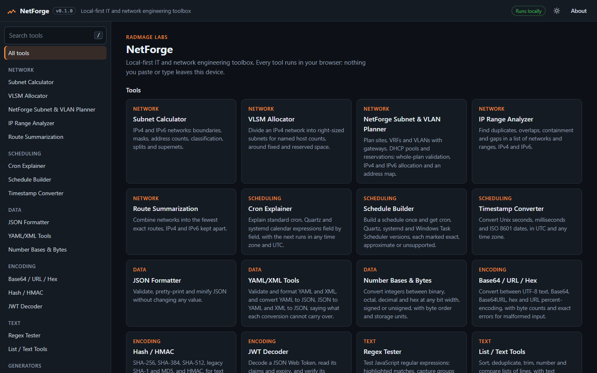
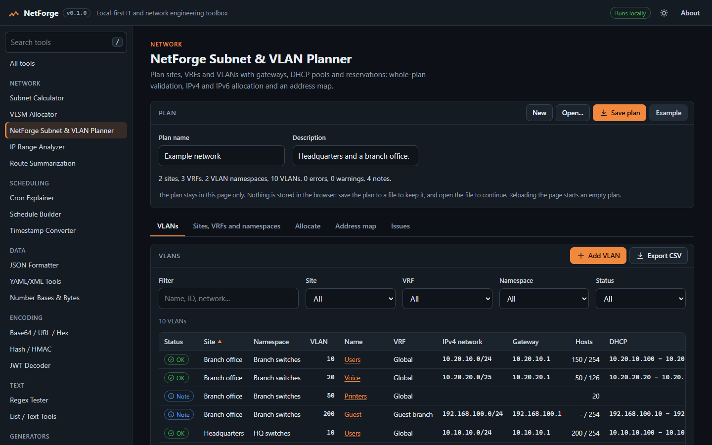
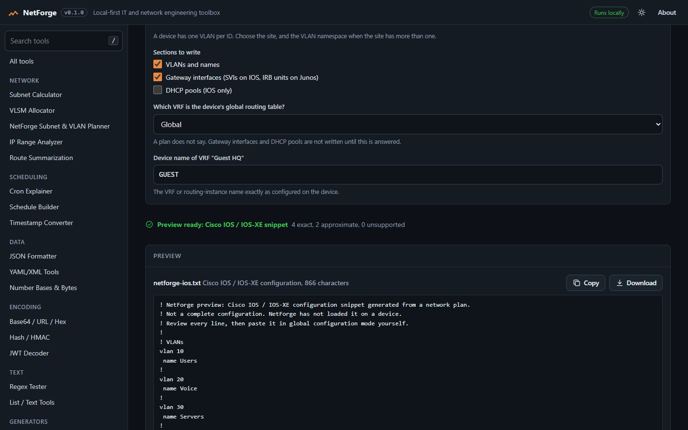
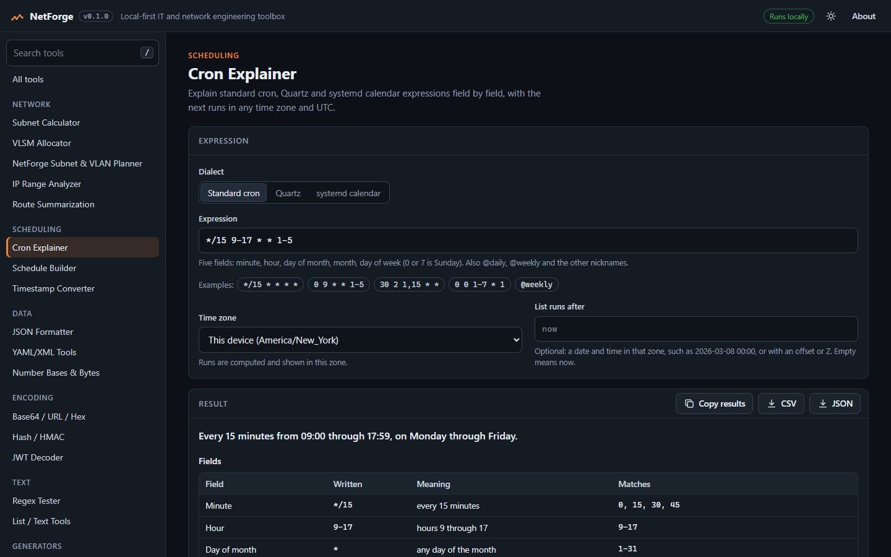
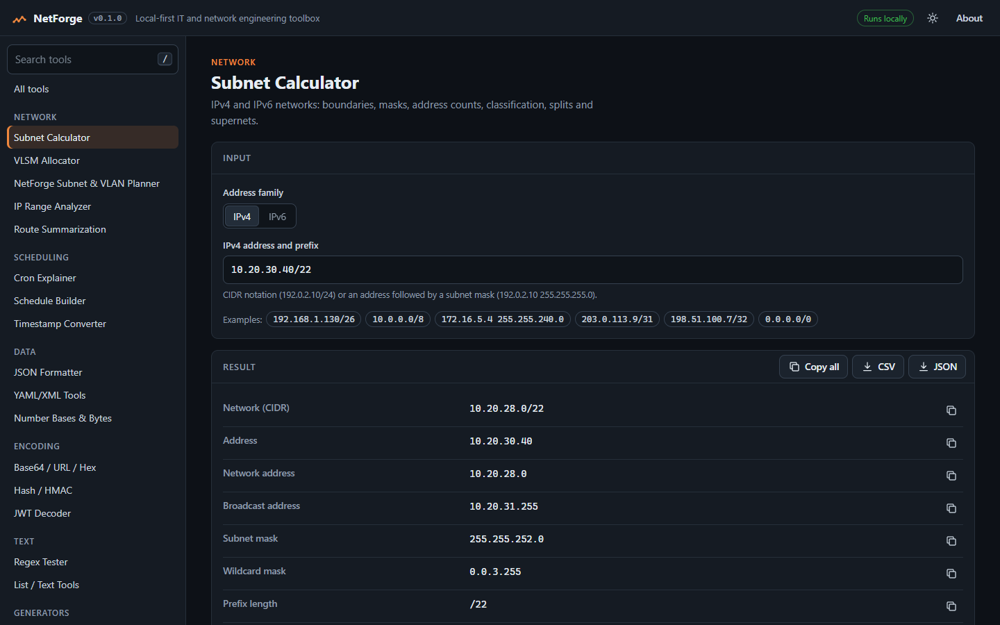

# NetForge

Local-first IT and network engineering toolbox.

NetForge is a collection of practical browser tools for systems administrators, network engineers and developers. Every tool runs entirely in your browser: nothing you paste or type is sent to a server.

**Version:** 0.1.0. Home: https://netforge.radmagelabs.com/



| Subnet & VLAN Planner | Cisco / Juniper Export |
|---|---|
|  |  |
| **Cron Explainer** | **Subnet Calculator** |
|  |  |

## Tools

Built:

- **Subnet Calculator** (IPv4 and IPv6): network boundaries, masks and exact address counts for any address and prefix. IPv4 handles /31 point-to-point links (RFC 3021), /32 host routes and /0 as the special cases they are. IPv6 accepts every standard text form, shows the RFC 5952 canonical and fully expanded forms, and never invents a broadcast address or IPv4-style usable-host counts. Also: address classification, splitting into equal subnets, and supernets. Copy any value, or export as CSV or JSON.
- **Address classification**: each address is checked against the IANA IPv4 and IPv6 special-purpose address registries (bundled, with their update dates), listing every matching block and its properties: private or local use, loopback, link-local, multicast and its scope, documentation, shared address space, benchmarking, reserved and others. "Globally reachable" is reported as the registry defines it, which is not the same as whether an address is routed on the Internet today.
- **VLSM Allocator**: divides an IPv4 network into right-sized subnets for named host counts, around fixed allocations and reserved ranges. Largest block first, each at the lowest free aligned address, so the same input always gives the same plan; requests that do not fit are reported with the reason. Optional /31 and /32 sizing for point-to-point links and single hosts.
- **NetForge Subnet & VLAN Planner**: plans sites, VRFs (routing domains), VLAN namespaces and VLANs, with IPv4 and IPv6 networks, gateways, DHCP pools, reserved addresses and host targets. The whole plan is checked as you type, and each finding is shown at the field it is about: VLAN IDs must be unique within a VLAN namespace (not per site, VRF or organization); networks must not overlap within a VRF or between VRFs that exchange routes, while reuse across independent VRFs is allowed and noted with the VRFs named; gateways, DHCP pools, reservations, capacity and optional site parent blocks are checked too. Automatic allocation fills IPv4 networks from host targets with the VLSM engine (across several parent blocks in order) and IPv6 prefixes, a /64 per VLAN by default, with exact counts and stated limits. Every allocation is previewed first, and networks that already exist are replaced only after you confirm. An address map shows any IPv4 or IPv6 space as a grid you can zoom into, with allocations, reservations, free space and conflicts. Plans are saved and opened as versioned JSON files; VLAN tables and findings export as CSV.
- **IP Range Analyzer**: finds duplicates, containment, partial overlaps and the gaps inside a parent network in a pasted list of CIDRs, addresses and ranges, IPv4 and IPv6, with problems reported by line number.
- **Route Summarization**: combines networks into the fewest exact routes without adding any address space, with IPv4 and IPv6 kept apart. A broader single supernet is shown separately, with the extra space it would cover.
- **JSON Formatter**: strict RFC 8259 validation with the exact line and column of any error, pretty-printing and minifying. Only whitespace changes: numbers, strings, escapes and duplicate property names are kept exactly as written, and integers too large for JavaScript are flagged instead of rounded.
- **Timestamp Converter**: Unix seconds, Unix milliseconds and ISO 8601 / RFC 3339 dates, shown in UTC and in any time zone. Local times that daylight saving time skips or repeats are reported as such instead of being silently shifted.
- **Cron Explainer**: reads standard five-field cron (Vixie cron as cronie and Debian cron follow it), Quartz cron and systemd calendar (`OnCalendar=`) expressions, each with its own parser and rules: one dialect is never read as another. Explains the expression and every field, warns about traps such as cron's day-of-month OR day-of-week rule, uneven steps and short months, and lists the next 10 runs in a chosen time zone and in UTC, with the zone's abbreviation and offset. Local times that a DST change skips or repeats are marked, with what that scheduler is known to do with them (systemd's behavior was checked against systemd 257; where cron daemons, Quartz or Windows differ or do not document it, the run is marked uncertain rather than predicted). Unsupported syntax is refused with the reason. Copy, CSV and JSON export.
- **Schedule Builder**: choose every N minutes, hourly, daily, weekdays, weekly or every N weeks, specific weekdays, or monthly (a date, the last day, or the first to fourth or last weekday), a time and a time zone, and get standard cron, Quartz, systemd and Windows Task Scheduler (PowerShell ScheduledTasks and `schtasks.exe`) versions. Each is labeled exact, approximate or unsupported; approximate versions list how their runs differ, unsupported ones say why, and every output states the conditions it relies on (such as the host's time zone) and how its scheduler handles DST. Each output's own next runs can be compared with the schedule. Optional names fill in the generated commands with safe quoting; without them the commands stay clearly marked templates. An optional systemd timer unit preview never invents the service it starts. NetForge never runs any command.

- **Base64 / URL / Hex**: converts between UTF-8 text, Base64, Base64URL, hexadecimal and URL percent-encoding in any direction, with byte counts. Strict by default: malformed Base64, hex, percent escapes and invalid UTF-8 are errors with their position, and nothing is repaired or replaced unless you turn on an option that says so. Decoded data that is not text can be downloaded as bytes.
- **Hash / HMAC**: SHA-256, SHA-384 and SHA-512, plus SHA-1 and MD5 labeled as legacy (MD5 is not suitable for anything security-sensitive), and HMAC-SHA256/384/512, for text or a file, in hex and Base64. SHA and HMAC come from the browser's Web Crypto API; MD5 is a small implementation of RFC 1321 checked against the RFC's test suite. Files are read and hashed on the device, in a worker. A published checksum can be pasted in to compare.
- **JWT Decoder**: decodes a JSON Web Token's header and claims, explains the registered claims, shows `exp`, `nbf` and `iat` as times, and checks them against the device clock and against an issuer and audience you expect. The signature can be verified with a key you supply (HS256/384/512 with a shared secret; RS256/384/512 and ES256/384/512 with a PEM public key, a JWK or a pasted JWK Set). Decoded, signature verified and claims checked are shown as three separate facts, and a verified signature is never presented as proof that a token is authorized. Unsupported algorithms, `alg: none`, key-type and curve mismatches, malformed signatures and private keys are refused, and a public key is never accepted as an HMAC secret. Keys are never fetched: `jku`, `x5u` and keys embedded in a token are ignored. Tokens and keys are never stored or put in the address bar.
- **Regex Tester**: JavaScript (ECMAScript) regular expressions, as this browser implements them, not PCRE or .NET. Highlighted matches, numbered and named capture groups, zero-length matches, match counts and a replacement preview. The pattern runs in a Web Worker under a two-second limit that is enforced by terminating the worker, so catastrophic backtracking cannot freeze the page. Output is bounded, and every limit that is reached is stated.
- **List / Text Tools**: trim, remove empty or duplicate lines, change case, sort (by character code, natural order or length), add prefixes and suffixes, number lines, compare two lists (intersection, differences, union) and count lines, words, characters and bytes. Case-sensitive or case-insensitive. With no operation selected the text is returned unchanged.
- **UUID / Random Tokens**: UUID version 4 and version 7 (RFC 9562) and random hex or Base64URL tokens of a chosen byte length, up to 1,000 at a time, from `crypto.getRandomValues` only. Shows the length and the number of random bits, and says what that number does and does not mean.
- **YAML/XML Tools**: validates and formats YAML (1.2) and XML, and converts YAML to JSON, JSON to YAML and XML to JSON. Formatting keeps comments, anchors, quoting and the spelling of numbers. Each conversion lists what the target format cannot hold (comments, aliases, non-string keys, layout whitespace) and refuses what would silently change meaning (infinity, duplicate keys). XML is read by NetForge's own parser, which loads no DTDs or external entities and expands no entities beyond the five built into XML; XML to JSON uses one explicit, documented model that keeps attributes, namespaces, comments and repeated elements in order.
- **Number Bases & Bytes**: converts whole numbers between binary, octal, decimal and hexadecimal with exact arithmetic at any size. Widths of 8, 16, 32, 64 and 128 bits, a custom width up to 4,096 bits or no fixed width, signed (two's complement) or unsigned. A value that does not fit is an error that states the allowed range, and an invalid digit is reported with its position. Shows both readings of the same bits, the bytes in big-endian and little-endian order, and converts storage amounts exactly between bits, bytes, decimal units (kB to EB) and binary units (KiB to EiB).
- **chmod Calculator**: Unix permission bits as check boxes, an octal mode and an `ls -l` string kept in step, with setuid, setgid and the sticky bit, separate explanations for files and directories, warnings for risky modes, and `chmod` commands to copy with the path quoted safely. A preview applies symbolic (`u+x,go-w`) and numeric changes the way GNU `chmod` does, including the umask and `X`. Windows NTFS permissions are access control lists, a different model: the page says so and offers no conversion between the two.

Exports. Each one is a preview to review, built from a plan saved by the planner, the plan open in the planner, or the example. NetForge runs nothing and connects to nothing. Every item is labeled exact, approximate (written, but something differs or is left out, with the reason) or unsupported (not written, with the reason), followed by the assumptions made, the manual steps left, and what the export never covers. A plan with validation errors is not exported. Text from a plan reaches the output only through a quoting or checking rule for that target; what cannot be written safely is left out and reported.

- **PowerShell Generator**: Windows DHCP Server scopes for the VLANs that have DHCP pools (the DhcpServer module): each scope covers its network's host range with everything outside the plan's pools excluded, the router option comes from the plan's gateway, and scopes are created inactive unless you choose otherwise. DNS servers, a DNS domain, a server name and reservations (address, MAC address, name) are written only if you enter them, because a plan does not hold them. The script states at the top that it needs administrator rights. Also: a read-only script that holds the plan as PowerShell objects, and a scheduled task example written by the same engine as the Schedule Builder, with marked placeholders for a task name or program you have not given.
- **Terraform Export**: the plan as provider-neutral JSON, as typed Terraform variables with their values (`.tfvars` in HCL or JSON syntax, the HCL laid out as `terraform fmt` writes it), or as an AWS VPC with subnets for the hashicorp/aws provider. The AWS export maps one parent block of one site and VRF to a VPC and each VLAN network inside it to a subnet, and says plainly that a VPC is not a VLAN or a VRF: VLAN IDs become tags only, and gateways, DHCP pools and reserved addresses that AWS cannot hold are listed as unsupported. It never writes an Availability Zone (each subnet reads one from a variable you fill in), a route table, a gateway or a provider block. IPv6 is written only when you state that the planned prefixes are in your own BYOIP pool.
- **Cisco / Juniper Export**: configuration snippets, not complete device configurations. For Cisco IOS / IOS-XE: VLANs and names, gateway interfaces (SVIs) with IPv4 and IPv6 addresses, VRF membership and DHCP pools with excluded addresses. For Juniper Junos (EX and QFX with ELS), as `set` commands: VLANs, IRB interfaces and routing-instance membership. The tool asks which VRF is the device's global routing table and what each VRF is called on the device instead of guessing. The output contains no command that removes, shuts down, saves or commits anything, and no port configuration. The snippets follow the vendors' command references and have not been loaded on a Cisco or Juniper device.

## Limits

Large inputs are refused with a message rather than cut or left to freeze the page: 8,000,000 characters for encoding, 512 MiB per file for hashing, 1,000,000 characters of text per regex run, 5,000,000 characters and 200,000 lines for text tools, 2,000,000 characters of YAML or JSON and 10,000,000 of XML, 5,000 characters and 4,096 bits for number conversion, 5,000 DHCP reservations and 2,000 AWS subnets per export. Hashing, regular expressions and YAML/XML processing run in workers with time limits.

## Privacy

- All processing happens in the browser. There is no server component, no analytics, no cookies and no third-party scripts, fonts or other resources.
- The production build sets a Content-Security-Policy with `connect-src 'none'`, so the page cannot open network connections. A policy in the page does not reach background workers, which take theirs from HTTP headers: each NetForge worker removes its own network interfaces when it starts, the service worker adds the policy to the worker scripts it serves, and the host sends the same policy as an HTTP header on every file, where it also forbids other sites from framing the app (see Hosting).
- Tool input stays in memory. A network plan is written only to a file you choose to save, and read only from a file you pick: it is never stored in the browser and never restored on its own. The export tools read a plan the same way, or take a copy of the planner's plan in memory, and store neither the plan nor anything typed into them (server names, DNS servers, MAC addresses, device VRF names). Schedule expressions, task names and commands are never stored either, and neither are tokens, keys, secrets, hashed text or files, generated values or anything else entered in the utilities. Only display preferences (theme, last tool, time zone and JSON indentation) are saved in local storage; the About page lists them and clears them.
- The address registries are bundled with the app (`data/iana/`), so classification needs no network access.
- NetForge ships one third-party library, the `yaml` parser (ISC license, no dependencies of its own), bundled into the build at a pinned version and loaded only by the YAML/XML tool. Nothing is fetched at run time.
- After the first visit, a service worker keeps a copy of the app so it works offline, and the app can be installed (it has a web app manifest and icons). The offline copy holds only NetForge's own files, never anything typed, opened or generated. A new version is offered with a Reload button and never replaces a running page on its own.

## Development

Requires Node.js 24 and Google Chrome (the browser tests drive the installed Chrome). The same tests run in Microsoft Edge (`npx playwright test --project=edge`) and in Playwright's Firefox and WebKit builds (`npm run test:engines`).

```sh
npm install
npm run dev                  # development server
npm test                     # unit tests (Vitest)
npm run build                # type check and production build into dist/
npm run test:e2e             # browser tests against the production build (Playwright)
npm run test:all             # all of the above
node scripts/mutations.mjs   # mutation check of the unit suite
```

Test expectations come from sources independent of the code under test: Python's `ipaddress` and `zoneinfo` modules (`scripts/oracles/` regenerates `tests/fixtures/`, including brute-force references for VLSM, IPv6 prefix allocation and plan validation), the JavaScript engine's own `JSON.parse` and `JSON.stringify`, `Date.prototype.toISOString`, and values worked out from the relevant RFCs, registries and time zone rules. Scheduling is checked against Python's `croniter` (only where it follows Vixie cron), brute-force cron and Quartz references written from their documentation, `systemd-analyze calendar` from systemd 257, and Windows PowerShell's own parser and in-memory ScheduledTasks trigger objects (nothing is registered). The utilities are checked against published vectors (RFC 1321, RFC 4231, RFC 4648, RFC 7515, RFC 9562), Python's `hashlib`, `hmac`, `base64`, `urllib`, `uuid`, PyYAML and expat, tokens signed by the OpenSSL command line, and the JavaScript engine's own `String.prototype.replace`; the browser tests verify signatures made by Node's OpenSSL in Chrome's Web Crypto. Number conversion is checked against Python's integers and fractions, and permission changes against GNU coreutils `chmod` run on Linux. Generated PowerShell is read back by Windows PowerShell's own parser (nothing is run), and every DHCP parameter is checked against Microsoft's published cmdlet reference; the commands have not been run against a DHCP server. The Terraform output is checked with the Terraform CLI (1.17.2) and the hashicorp/aws provider (6.73.0): `terraform validate` accepts every generated configuration, `terraform plan` shows the planned VPC, subnets, tags and references equal to the plan, and the values in the generated `.tfvars` files are read back by Terraform unchanged. Nothing is applied, so rules that only AWS enforces are not checked. The Cisco and Junos snippets are checked by a line grammar written from the vendors' documented syntax and against the vendors' command references; they have not been loaded on a device.

The classification data is generated from the IANA files in `data/iana/` by `node scripts/registry/build-registry.mjs`; the unit tests fail if the generated module and the files disagree.

## Hosting

NetForge is a static site with its own origin, https://netforge.radmagelabs.com/, so its preferences and offline copy are shared with no other app. The build uses relative paths: `dist/` works at a site root, under a subpath and from `npm run preview` without a rebuild.

`vercel.json` holds the host configuration. Every response carries the Content-Security-Policy as an HTTP header (with `frame-ancestors 'none'`, and `connect-src 'self'` for the service worker script only, which has to fetch the app's files), `X-Content-Type-Options: nosniff`, `X-Frame-Options: DENY`, `Referrer-Policy: no-referrer`, a Permissions-Policy that turns off the device features NetForge never uses, `Cross-Origin-Opener-Policy` and `Cross-Origin-Resource-Policy: same-origin`, and `Strict-Transport-Security`. Files under `assets/` have content hashes in their names and are cached for a year; everything else is revalidated on each visit, so a new version is found at once.

The browser tests apply these same rules through a local server and check that a worker cannot connect out on a first visit, that another site cannot frame the app, and that the app still installs, updates and works offline under them. A host that cannot send response headers leaves the first two unprotected.

## License

MIT. Copyright (c) 2026 RadMage Labs. See `LICENSE`.

Published by RadMage Labs.
